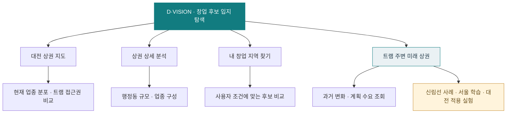
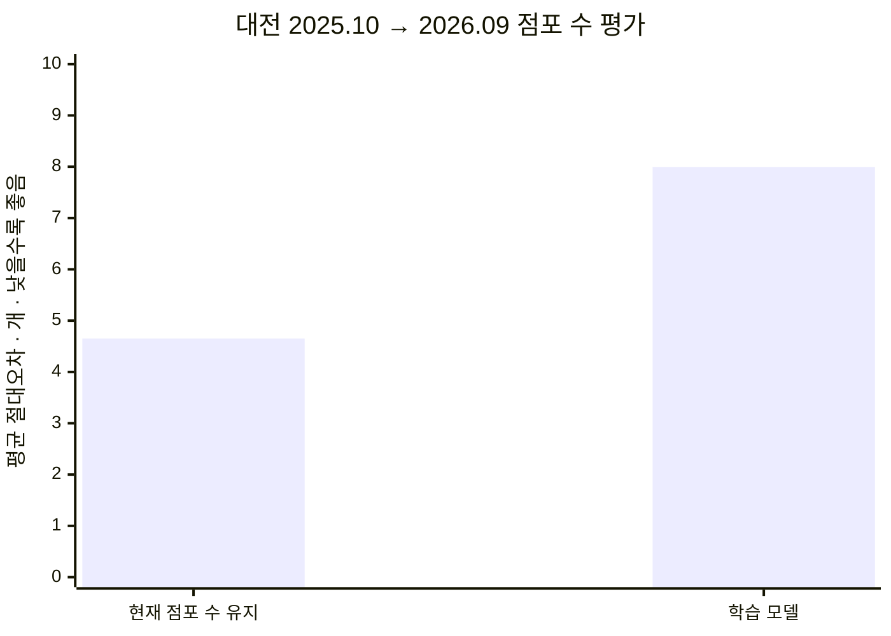

# D·VISION

> 프로젝트 발표용 후속 개발 · 대전 트램 예정지 주변 상권 분석과 미래 예측 가능성 검증

대전의 현재 상권과 계획된 트램 정거장 접근권을 함께 살펴보고, 창업 후보 입지를 비교하는 웹사이트입니다. 미래 매출·유동인구·창업 성공을 예측하지 않습니다.

## 서비스 구성 한눈에 보기



구성도는 현재 메뉴와 기능의 관계를 나타냅니다. 학습·전망 실험은 실제 트램 개통 효과나 창업 성공 예측과 구분합니다.

## 대회 제출본과 프로젝트 발표용 구분

**이 브랜치는 `project-presentation`이며 대회 제출 이후의 후속 작업입니다.** 평가 중인 `main`과 제출 태그 `v1.0.0-contest`는 커밋 `2f9387d25bcfe2d4177bd94cb56c21fea8afdb0a`에 유지합니다. 기존 심사용 Streamlit 웹은 `main`을 사용하며 이번 후속 작업을 배포하지 않습니다.

- **[팀원용 진행상황 공유 문서](PROJECT_STATUS_2026-11-14.md)**: 구현 범위, 모델 성능, 한계, 발표 설명, 실행 방법
- [대회 제출본 코드](https://github.com/Data-market-traffic-insights/D_vision/tree/v1.0.0-contest)
- [프로젝트 발표용 코드](https://github.com/Data-market-traffic-insights/D_vision/tree/project-presentation)

발표용은 이 브랜치의 `demo/`를 로컬에서 실행해 확인하세요. 기존 공개 대회용 주소에서는 후속 기능을 볼 수 없습니다. `demo/`에는 좌표 관리자 기능이 없습니다.

## 실행 방법

Python **3.12**를 권장합니다. GitHub 상단의 **Code → Download ZIP**으로 내려받아 압축을 푼 뒤, 터미널에서 `demo` 폴더로 이동합니다. 아래 명령은 `demo` 폴더 안에서 실행합니다.

### macOS·Linux

```bash
python3.12 -m venv .venv
source .venv/bin/activate
python -m pip install -r requirements.txt
python -m streamlit run prototype_app.py --server.port 8502 --server.address 127.0.0.1
```

### Windows 명령 프롬프트

```bat
py -3.12 -m venv .venv
.venv\Scripts\activate.bat
python -m pip install -r requirements.txt
python -m streamlit run prototype_app.py --server.port 8502 --server.address 127.0.0.1
```

브라우저에서 **[http://localhost:8502](http://localhost:8502)**에 접속합니다. 이 주소는 실행한 컴퓨터에서만 열립니다. 다른 사람에게 공유할 공개 주소가 아닙니다. 종료는 실행 중인 터미널에서 **Ctrl+C**를 누릅니다. 지도 배경을 불러오려면 인터넷 연결이 필요합니다. 포트가 사용 중이면 명령의 `8502`를 다른 번호로 바꾸고 같은 번호의 주소를 여세요.

처음 한 번 환경을 만들고 패키지를 설치한 뒤에는 해당 가상환경을 활성화하고 마지막 실행 명령만 사용하면 됩니다. macOS에서는 `sh run.sh --server.port 8502 --server.address 127.0.0.1`도 사용할 수 있습니다.

## 이렇게 확인해 보세요

1. **대전 상권 지도 → 현재 상권**: 상가 밀집도·업종별 분포·AI 상권 유형 지도를 바꿔 보세요.
2. **트램 연계 시나리오**: 정거장·업종을 선택하고 300m·500m·1km의 현재 상권과 다른 정거장을 비교하세요.
3. **신규 접근권 편입 후보**: 기존 1호선 전체 역과 검토된 트램 정거장을 같은 반경으로 비교하세요.
4. **내 창업 지역 찾기**: 업종·경험·중요 조건 한두 가지를 선택해 최대 5개 후보의 부합도와 근거를 확인하세요.
5. **상권 상세 분석**: 관심 행정동의 상가 규모·주요 업종·트램 접근권을 확인하세요.
6. **트램 주변 미래 상권**: 대전 과거 변화·계획 수요, 신림선 비교 분석, 서울 분기 학습, 대전 적용 실험을 구분해 확인하세요.

## 확인할 수 있는 주요 수치

| 항목 | 현재 값 | 기준·범위 |
|---|---:|---|
| 등록 상가 | **79,691개** | 2026년 9월 대전 |
| 행정동 / 업종 | **82개 / 10개** | 현재 분석 자료 |
| 상권 유형 | **3개** | 저장된 K-means, K=3 |
| 공간 분석 정거장 | **5개 / 전체 45개** | 검토·승인된 근사 좌표만 사용 |
| 유성온천 주변 전체 / 음식 | **1,663개 / 442개** | 직선 500m, 음식은 전체의 부분집합 |
| 관저 주변 전체 | **404개** | 직선 500m |
| 신규 접근권 편입 후보 | **1,036개 / 1,593개** | 각각 300m / 500m, 현재 상가 수 |

## 현재 구현 범위와 한계

**현재 D·VISION은 1호선의 과거 상권 변화를 학습해 2호선의 미래 상권을 예측하는 모델이 아닙니다.** 1호선은 역 위치와 접근권을 비교하는 기준으로 사용하며, 개통 전후의 상가 수·매출·유동인구 변화 자료는 현재 분석에 사용하지 않습니다.

| 기능 | 현재 제공하는 내용 | 현재 제공하지 않는 내용 |
|---|---|---|
| 신규 트램 접근권 | 기존 1호선 반경 밖이면서 계획된 트램 반경 안에 있는 현재 상가 추출 | 개통 후 상가 수·매출·방문객 증가량 예측 |
| 증가·유지·감소 시나리오 | 가정별로 살펴볼 현재 지표와 현장 확인 사항 안내 | 미래 증가율·감소율이나 변화량의 수치 계산 |
| K-means·입지 추천 | 현재 행정동 상권 유형과 사용자 조건 부합도 비교 | 미래 성장성·수익성·창업 성공 확률 예측 |

예를 들어 500m 기준 신규 접근권 후보 **1,593개**는 해당 공간 조건에 속하는 **현재 상가 수**입니다. 미래에 늘어날 상가 수나 방문객 수가 아닙니다. 시나리오에서 ‘증가’를 선택해도 미래 수요가 자동으로 계산되지는 않습니다.

트램은 전체 45개 중 검토·승인된 **근사 좌표 5개**만 사용합니다. 반경은 직선거리이며 실제 보행거리·시간이나 검증된 경제적 영향 범위가 아닙니다. 버스 등 다른 교통수단도 비교하지 않습니다. 지도는 상가가 많으면 최대 3,000개 표본을 표시하지만 통계는 전체 자료로 계산합니다.

## 추가한 분석·학습 실험

- **대전 예정지 분석:** 2023.09·2024.09·2025.10·2026.09의 점포 수와 업종 비중을 비교합니다. 추세 외삽과 현재 수준 유지, 2030년 계획 수요에 대한 사용자 가정을 구분합니다.
- **신림선 개통 사례:** 개통 전후 점포 변화를 비교 상권과 대조합니다. 대전 트램의 개통 효과로 그대로 옮기지 않습니다.
- **서울 분기 모델:** 다음 분기·1년 뒤 점포 수를 학습하고 2025년 실제 자료로 평가했습니다. 일부 조건의 개선이 대전 성능을 의미하지는 않습니다.
- **대전 적용 모델:** 같은 전국 상가자료로 서울·대전의 공간·업종 기준을 맞춘 별도 연간 모델입니다. 대전 2026년 MAE는 모델 **7.9925개**, 유지 기준 **4.6500개**로 모델이 더 못했습니다. 2027년 수치는 비교 실험으로 표시합니다.

### 대전 적용 실험의 오차 비교



| 비교 방법 | 평균 절대오차(MAE) | 이번 평가 해석 |
|---|---:|---|
| 현재 점포 수 유지 | **4.6500개** | 학습 모델보다 오차가 작음 |
| 학습 모델 · 그래디언트 부스팅 | **7.9925개** | 유지 기준보다 성능이 낮음 |

출처: [`demo/data/daejeon_transfer/metrics.csv`](demo/data/daejeon_transfer/metrics.csv). 대전 5개 정거장 × 4개 업종의 한 구간 평가이며, 업종·반경 중복으로 20개 독립 표본은 아닙니다. MAE는 정확도 백분율이나 미래 오차 범위가 아닙니다.

**실용적인 대전 미래 예측 성능과 트램의 인과효과는 확보하지 못했습니다.** 현재 상권·과거 변화 분석을 중심으로 발표하고 예측은 검증 결과와 한계를 설명하는 실험으로 남깁니다. 추가 시계열, 여러 지역·기간 검증, 실제 개통 전후 자료의 확보가 후속 과제입니다.

자세한 입력·검증·한계는 [진행상황 공유 문서](PROJECT_STATUS_2026-11-14.md)에서 확인할 수 있습니다.

## 폴더 안내

- [demo/](demo/README.md): 심사·팀원 체험용 웹사이트. 좌표 관리자 기능이 없습니다.
- [development/](development/README.md): 현재 개발 코드·좌표 관리·기본 테스트. 외부 체험에는 사용하지 마세요.
- [데이터 출처와 분석 한계](demo/DATA_SOURCES_AND_LIMITS.md)

과거 개발 보고서·검증 자료·코드 사본·CAD·백업은 현재 공개 파일 구성에서 제외하고 로컬에 보존합니다. 원천 데이터·도면 발췌·지도 파생좌표의 권리와 이용 조건은 데이터 안내를 확인해 주세요.

## 대회 웹 배포 보호

기존 심사용 배포는 `main` 브랜치의 `demo/prototype_app.py`를 사용합니다. **프로젝트 발표용 브랜치를 대회용 `main`에 병합하거나, 기존 앱의 배포 브랜치를 변경하지 않습니다.**

프로젝트 발표용은 현재 로컬 실행 대상으로 공유합니다. 별도 공개 주소가 필요하면 대회 앱과 다른 앱으로 분리해 배포해야 합니다.
